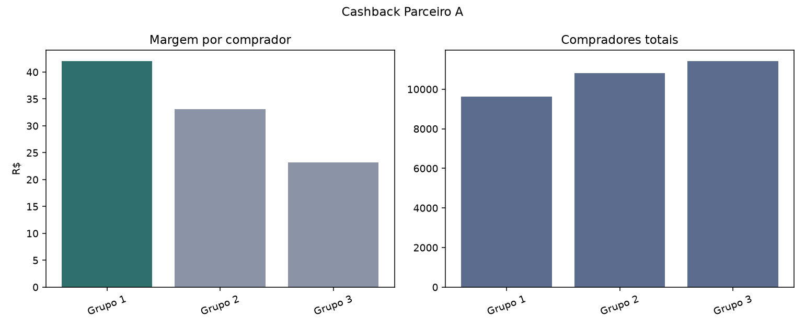

# Relatório de Teste A/B - Cashback Parceiro A

## Resumo executivo

**Decisão:** Escalar Grupo 1 para 100% do tráfego

Escalar Grupo 1 para 100% do tráfego. A variante tem a maior margem por comprador entre as opções viáveis (R$ 42,01) e a diferença é estatisticamente robusta pelo IC95 do bootstrap.

**Descrição:** 3 faixas de cashback, teste concorrente por data

**Parceiro:** Parceiro A  
**Período:** 2011-01-01 a 2011-04-02  
**Variantes:** Grupo 1, Grupo 2, Grupo 3  
**Dias por variante:** {'Grupo 1': 92, 'Grupo 2': 92, 'Grupo 3': 92}

## Resumo por variante

| Grupos de usuários   |   compradores_total |   dias |   vendas_total |   comissao_total |   cashback_total |   margem_total |   margem_por_comprador |   ticket_medio |   cashback_pct_vendas |   roi_cashback |
|:---------------------|--------------------:|-------:|---------------:|-----------------:|-----------------:|---------------:|-----------------------:|---------------:|----------------------:|---------------:|
| Grupo 1              |                9633 |     92 |    5.60517e+06 |           638135 |           233424 |         404711 |                  42.01 |         581.87 |                  4.16 |           1.73 |
| Grupo 2              |               10814 |     92 |    6.4231e+06  |           728178 |           370659 |         357519 |                  33.06 |         593.96 |                  5.77 |           0.96 |
| Grupo 3              |               11410 |     92 |    6.78586e+06 |           767887 |           503600 |         264287 |                  23.16 |         594.73 |                  7.42 |           0.52 |

## Comparação estatística

Métrica comparada: diferença de margem por comprador contra a baseline. O critério de decisão é o IC95 excluir zero; a taxa de vitória no bootstrap é exibida apenas como leitura intuitiva.

| variante   | vs_baseline   |   dif_margem_por_comprador_media |   ic95_low |   ic95_high |   prob_variante_supera_baseline |   n_dias_variante |   n_dias_baseline | pareamento_usado   | amostra_pequena_lt30d   | tipo_bootstrap   |
|:-----------|:--------------|---------------------------------:|-----------:|------------:|--------------------------------:|------------------:|------------------:|:-------------------|:------------------------|:-----------------|
| Grupo 2    | Grupo 1       |                          -8.9417 |   -10.598  |     -7.2586 |                               0 |                92 |                92 | True               | False                   | pareado por data |
| Grupo 3    | Grupo 1       |                         -18.8289 |   -21.6616 |    -15.8571 |                               0 |                92 |                92 | True               | False                   | pareado por data |

## Qualidade dos dados

- Linhas originais: 276
- Linhas válidas: 276
- Linhas removidas na limpeza: 0
- Duplicatas removidas: 0
- Linhas inválidas removidas: 0
- Colunas extras ignoradas: []
