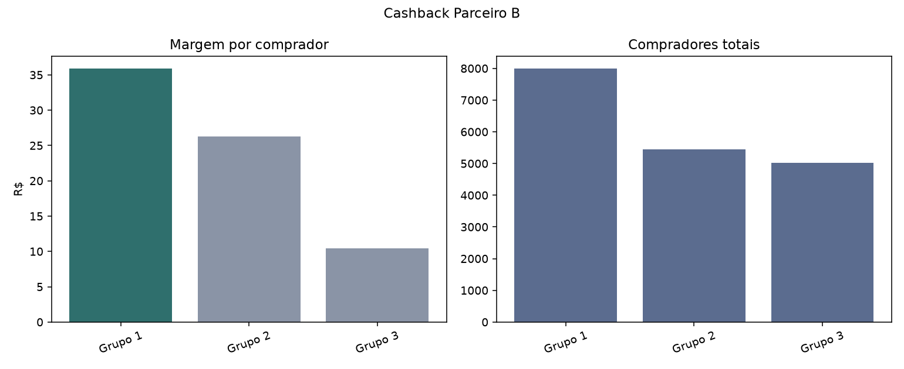

# Relatório de Teste A/B - Cashback Parceiro B

## Resumo executivo

**Decisão:** Escalar Grupo 1 para 100% do tráfego

Escalar Grupo 1 para 100% do tráfego. A variante tem a maior margem por comprador entre as opções viáveis (R$ 35,87) e a diferença é estatisticamente robusta pelo IC95 do bootstrap.

**Descrição:** 3 faixas de cashback, teste concorrente por data

**Parceiro:** Parceiro B  
**Período:** 2011-05-01 a 2011-06-30  
**Variantes:** Grupo 1, Grupo 2, Grupo 3  
**Dias por variante:** {'Grupo 1': 61, 'Grupo 2': 61, 'Grupo 3': 61}

## Resumo por variante

| Grupos de usuários   |   compradores_total |   dias |   vendas_total |   comissao_total |   cashback_total |   margem_total |   margem_por_comprador |   ticket_medio |   cashback_pct_vendas |   roi_cashback |
|:---------------------|--------------------:|-------:|---------------:|-----------------:|-----------------:|---------------:|-----------------------:|---------------:|----------------------:|---------------:|
| Grupo 1              |                7990 |     61 |    4.09382e+06 |           450321 |           163751 |         286570 |                  35.87 |         512.37 |                     4 |           1.75 |
| Grupo 2              |                5452 |     61 |    2.86302e+06 |           314935 |           171778 |         143157 |                  26.26 |         525.13 |                     6 |           0.83 |
| Grupo 3              |                5029 |     61 |    2.62996e+06 |           289290 |           236697 |          52593 |                  10.46 |         522.96 |                     9 |           0.22 |

## Comparação estatística

Métrica comparada: diferença de margem por comprador contra a baseline. O critério de decisão é o IC95 excluir zero; a taxa de vitória no bootstrap é exibida apenas como leitura intuitiva.

| variante   | vs_baseline   |   dif_margem_por_comprador_media |   ic95_low |   ic95_high |   prob_variante_supera_baseline |   n_dias_variante |   n_dias_baseline | pareamento_usado   | amostra_pequena_lt30d   | tipo_bootstrap   |
|:-----------|:--------------|---------------------------------:|-----------:|------------:|--------------------------------:|------------------:|------------------:|:-------------------|:------------------------|:-----------------|
| Grupo 2    | Grupo 1       |                          -9.5921 |   -10.9164 |     -8.2829 |                               0 |                61 |                61 | True               | False                   | pareado por data |
| Grupo 3    | Grupo 1       |                         -25.4044 |   -26.3832 |    -24.4298 |                               0 |                61 |                61 | True               | False                   | pareado por data |

## Qualidade dos dados

- Linhas originais: 183
- Linhas válidas: 183
- Linhas removidas na limpeza: 0
- Duplicatas removidas: 0
- Linhas inválidas removidas: 0
- Colunas extras ignoradas: []
