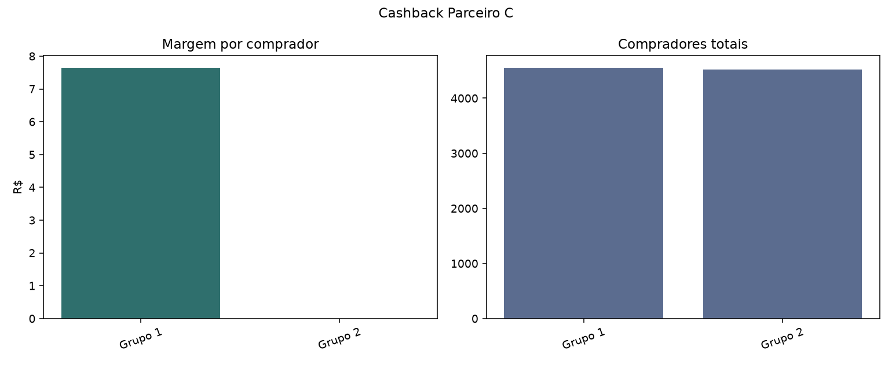

# Relatório de Teste A/B - Cashback Parceiro C

## Resumo executivo

**Decisão:** Escalar Grupo 1 para 100% do tráfego

Escalar Grupo 1 para 100% do tráfego. A variante tem a maior margem por comprador entre as opções viáveis (R$ 7.64) e a diferença é estatisticamente robusta pelo IC95 do bootstrap.

**Descrição:** 2 faixas de cashback, teste concorrente por data

**Parceiro:** Parceiro C  
**Período:** 2011-07-01 a 2011-08-14  
**Variantes:** Grupo 1, Grupo 2  
**Dias por variante:** {'Grupo 1': 45, 'Grupo 2': 45}

### Alertas críticos

- **Atenção:** Grupo 2 tem margem total <= R$ 0 (R$ 0.00). Essa variante queima receita e não deve ser escalada, independentemente de volume ou resultado estatístico.

## Resumo por variante

| Grupos de usuários   |   compradores_total |   dias |   vendas_total |   comissao_total |   cashback_total |   margem_total |   margem_por_comprador |   ticket_medio |   cashback_pct_vendas |   roi_cashback |
|:---------------------|--------------------:|-------:|---------------:|-----------------:|-----------------:|---------------:|-----------------------:|---------------:|----------------------:|---------------:|
| Grupo 1              |                4549 |     45 |    1.73846e+06 |           121693 |            86924 |          34769 |                   7.64 |         382.16 |                     5 |            0.4 |
| Grupo 2              |                4522 |     45 |    1.68524e+06 |           117967 |           117967 |              0 |                   0    |         372.67 |                     7 |            0   |

## Comparação estatística

Métrica comparada: diferença de margem por comprador contra a baseline. O critério de decisão é o IC95 excluir zero; a taxa de vitória no bootstrap é exibida apenas como leitura intuitiva.

| variante   | vs_baseline   |   dif_margem_por_comprador_media |   ic95_low |   ic95_high |   prob_variante_supera_baseline |   n_dias_variante |   n_dias_baseline | pareamento_usado   | amostra_pequena_lt30d   | tipo_bootstrap   |
|:-----------|:--------------|---------------------------------:|-----------:|------------:|--------------------------------:|------------------:|------------------:|:-------------------|:------------------------|:-----------------|
| Grupo 2    | Grupo 1       |                          -7.6427 |    -7.8878 |     -7.3936 |                               0 |                45 |                45 | True               | False                   | pareado por data |

## Qualidade dos dados

- Linhas originais: 90
- Linhas válidas: 90
- Linhas removidas na limpeza: 0
- Duplicatas removidas: 0
- Linhas inválidas removidas: 0
- Colunas extras ignoradas: []
